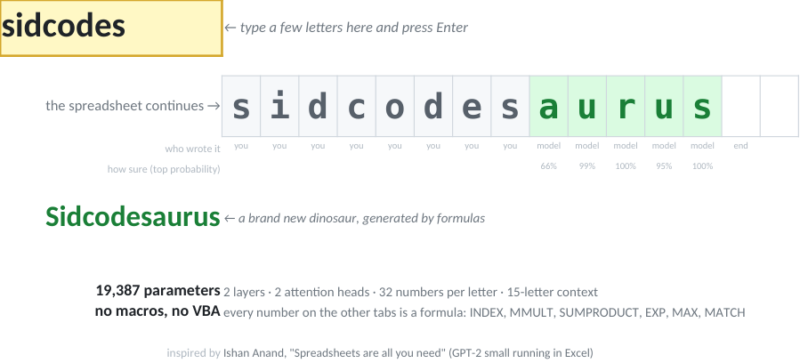
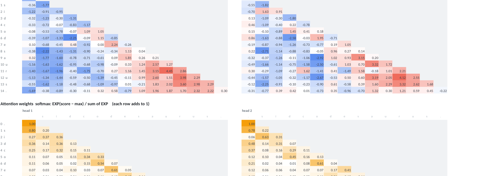

# excelllm

A tiny GPT that runs entirely on spreadsheet formulas.

Download `llm.xlsx`, type a few letters in `Prompt!A1`, press Enter, and the sheet finishes them
into a made-up dinosaur name. No VBA, no macros, no add-ins: just INDEX, MMULT, SUMPRODUCT, EXP,
MAX and MATCH.

    sidcodes -> Sidcodesaurus      excel   -> Excelosaurus      grandma -> Grandmasaurus
    beyonce  -> Beyonceratops      chatgpt -> Chatgpteryx       bezos   -> Bezosaurus



If Excel opens it in Protected View, click **Enable Editing** so it recalculates.

## What's inside

| | |
|---|---|
| Model | character-level transformer: 2 layers, 2 attention heads, 32 numbers per letter, 15-letter context |
| Parameters | 19,387, every one of them a cell in the workbook |
| Training data | 2,053 dinosaur genus names from the Paleobiology Database |
| Workbook | 9 tabs, 10,456 formulas |

Read the tabs left to right; that's the forward pass. There is one row per position and one column
per number. Position t only reads rows at or before t, so the whole model is unrolled down the
sheet, and generating text is just a chain of ordinary formulas.

| Tab | What it does |
|---|---|
| **Prompt** | Type here. Your letters show grey, the model's letters green. |
| **Tokens** | Cleans the prompt and turns letters into numbers. Each new letter is the model's previous answer. |
| **Embeddings** | `INDEX` looks up 32 numbers per letter, plus 32 for its position. |
| **Layer 1 / 2 Attention** | LayerNorm, then queries, keys and values with `MMULT`. Scores use `SUMPRODUCT`; the grey triangle is the causal mask (a letter can't see the future); softmax is `EXP` over a sum. |
| **Layer 1 / 2 MLP** | `MMULT` up to 64 numbers, ReLU as `MAX(0, x)`, `MMULT` back down. |
| **Logits** | A score for every possible next letter; `MATCH(MAX(...))` picks the winner. |
| **How it works** | The same explanation, inside the workbook. |



## Run it in Python

The same model in PyTorch gives the same names:

```bash
pip install -r requirements.txt
python src/generate.py excel sidcodes chatgpt
```

Train your own and turn it into a spreadsheet:

```bash
python src/train.py --corpus data/dinos.txt --out runs/mine --block 15 --steps 6000 --dropout 0.2 --wd 0.1 --seed 2
python src/export.py --run runs/mine --out mine.xlsx
```

Training takes a few minutes on a CPU. Any list of words works as a corpus, one per line, a–z only.

## Files

- `llm.xlsx`: the spreadsheet
- `model/`: the trained weights it was built from
- `src/model.py`: the transformer, written op for op the way the sheet computes it
- `src/train.py`, `src/export.py`, `src/generate.py`: train, write the workbook, sample in PyTorch
- `data/dinos.txt`: training names (see `data/SOURCES.md`)

## Credits

Inspired by Ishan Anand's [Spreadsheets are all you need](https://spreadsheets-are-all-you-need.ai/),
GPT-2 small implemented in Excel. Dinosaur names from the [Paleobiology Database](https://paleobiodb.org)
(CC BY 4.0).

Checked against PyTorch in LibreOffice and an independent formula engine; it hasn't been tested in
Microsoft Excel yet.
